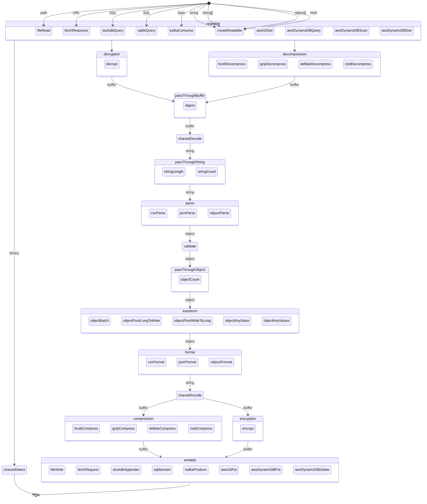

<div align="center">
<!--<br/><br/><br/><br/><br/><br/><br/>
<br/><br/><br/><br/><br/><br/><br/>-->
<h1>&lt;datastream&gt;</h1>
<p>Commonly used stream patterns for Web Streams API and NodeJS Stream.</p>
<p>If you're iterating over an array more than once, it's time to use streams.</p>
<br />
<p>
  <a href="https://github.com/willfarrell/datastream/actions/workflows/test-unit.yml"></a>
  <a href="https://github.com/willfarrell/datastream/actions/workflows/test-dast.yml"></a>
  <a href="https://github.com/willfarrell/datastream/actions/workflows/test-bench.yml"></a>
  <a href="https://github.com/willfarrell/datastream/actions/workflows/test-sast.yml"></a>
  <a href="https://github.com/willfarrell/datastream/actions/workflows/test-lint.yml"></a>
  <br/>
  <a href="https://www.npmjs.com/package/@datastream/core"></a>
  <a href="https://packagephobia.com/result?p=@datastream/core"></a>
  <a href="https://www.npmjs.com/package/@datastream/core">
  </a>
  <a href="https://www.npmjs.com/package/@datastream/core#provenance">
  </a>
  <br/>
  <a href="https://scorecard.dev/viewer/?uri=github.com/willfarrell/datastream"></a>
  <a href="https://slsa.dev"></a>
  <a href="https://github.com/willfarrell/datastream/blob/main/.github/CODE_OF_CONDUCT.md"></a>
  <a href="https://biomejs.dev"></a>
  <a href="https://conventionalcommits.org"></a>
  <a href="https://github.com/willfarrell/datastream/blob/main/package.json#L22">
  </a>
</p>
</div>

- [`@datastream/core`](packages/core)
  - pipeline
  - pipejoin
  - result
  - streamToArray
  - streamToObject
  - streamToString
  - streamToBuffer
  - isReadable
  - isWritable
  - makeOptions
  - createReadableStream
  - createPassThroughStream
  - createTransformStream
  - createWritableStream
  - resolveLazy
  - timeout
  - createChunkDecoder
  - concatBytes
  - backpressureGauge (Node only)

## Streams

- Readable: The start of a pipeline of streams that injects data into a stream.
- PassThrough: Does not modify the data, but listens to the data and prepares a result that can be retrieved.
- Transform: Modifies data as it passes through.
- Writable: The end of a pipeline of streams that stores data from the stream.

### Basics

- [`@datastream/string`](packages/string)
  - stringLengthStream [PassThrough]
  - stringCountStream [PassThrough]
  - stringMinimumFirstChunkSizeStream [Transform]
  - stringMinimumChunkSizeStream [Transform]
  - stringSkipConsecutiveDuplicatesStream [Transform]
  - stringReplaceStream [Transform]
  - stringSplitStream [Transform]
- [`@datastream/object`](packages/object)
  - objectCountStream [PassThrough]
  - objectBatchStream [Transform]
  - objectPivotLongToWideStream [Transform]
  - objectPivotWideToLongStream [Transform]
  - objectKeyValueStream [Transform]
  - objectKeyValuesStream [Transform]
  - objectKeyJoinStream [Transform]
  - objectKeyMapStream [Transform]
  - objectValueMapStream [Transform]
  - objectPickStream [Transform]
  - objectOmitStream [Transform]
  - objectFromEntriesStream [Transform]
  - objectToEntriesStream [Transform]
  - objectSkipConsecutiveDuplicatesStream [Transform]

### Common

- [`@datastream/file`](packages/file)
  - fileReadStream [Readable]
  - fileWriteStream [Writable]
- [`@datastream/fetch`](packages/fetch)
  - fetchReadableStream (alias fetchResponseStream) [Readable]
  - fetchWritableStream (alias fetchRequestStream) [Writable]
  - fetchSetDefaults (set default fetch options)
  - fetchRateLimit (one rate-limited request, resolves the `Response`)
- [`@datastream/base64`](packages/base64)
  - base64EncodeStream [Transform]
  - base64DecodeStream [Transform]
- [`@datastream/charset[/{detect,decode,encode}]`](packages/charset)
  - charsetDetectStream [PassThrough]
  - charsetDecodeStream [Transform]
  - charsetEncodeStream [Transform]
- [`@datastream/compress[/{gzip,deflate,brotli,zstd}]`](packages/compress)
  - gzipCompressStream [Transform]
  - gzipDecompressStream [Transform]
  - deflateCompressStream [Transform]
  - deflateDecompressStream [Transform]
  - brotliCompressStream [Transform]
  - brotliDecompressStream [Transform]
  - zstdCompressStream [Transform] (Node only)
  - zstdDecompressStream [Transform] (Node only)
- [`@datastream/digest`](packages/digest)
  - digestStream [PassThrough]

### Advanced

- [`@datastream/csv`](packages/csv)
  - csvDetectDelimitersStream [Transform] (decodes bytes to text)
  - csvDetectHeaderStream [Transform] (decodes bytes to text, strips the header row)
  - csvParseStream [Transform]
  - csvRemoveEmptyRowsStream [Transform]
  - csvRemoveMalformedRowsStream [Transform]
  - csvCoerceValuesStream [Transform]
  - csvArrayToObjectStream [Transform]
  - csvObjectToArrayStream [Transform]
  - csvInjectHeaderStream [Transform]
  - csvFormatStream [Transform]
  - csvQuotedParser, csvUnquotedParser (parsers for `csvParseStream`'s `parser` option)
- [`@datastream/json`](packages/json)
  - jsonParseStream [Transform]
  - jsonFormatStream [Transform]
  - ndjsonParseStream [Transform]
  - ndjsonFormatStream [Transform]
- [`@datastream/encrypt`](packages/encrypt)
  - encryptStream [Transform]
  - decryptStream [Transform]
  - generateEncryptionKey
- [`@datastream/validate`](packages/validate)
  - validateStream [Transform]
  - transpileSchema (precompile a JSON Schema)
- [`@datastream/arrow`](packages/arrow)
  - arrowDetectSchemaStream [PassThrough]
  - arrowBatchFromArrayStream [Transform]
  - arrowBatchFromObjectStream [Transform]
  - arrowToArrayStream [Transform]
  - arrowToObjectStream [Transform]
- [`@datastream/duckdb`](packages/duckdb)
  - duckdbConnect (connection helper)
  - duckdbQueryStream [Readable]
  - duckdbAppenderStream [Writable]
  - duckdbArrowInsertStream [Writable]
- [`@datastream/indexeddb`](packages/indexeddb) (browser only)
  - indexedDBConnect (connection helper)
  - indexedDBReadStream [Readable]
  - indexedDBWriteStream [Writable]
- [`@datastream/ipfs`](packages/ipfs)
  - ipfsGetStream [Readable]
  - ipfsAddStream [Writable]
- [`@datastream/avro`](packages/avro) (Node only)
  - avroEncodeStream [Transform]
  - avroDecodeStream [Transform]
- [`@datastream/protobuf`](packages/protobuf)
  - protobufEncodeStream [Transform]
  - protobufDecodeStream [Transform]
  - protobufLengthPrefixFrameStream [Transform]
  - protobufLengthPrefixUnframeStream [Transform]
- [`@datastream/schema-registry`](packages/schema-registry)
  - confluentFrameStream [Transform]
  - confluentUnframeStream [Transform]
  - glueFrameStream [Transform]
  - glueUnframeStream [Transform]
  - confluentSchemaRegistryResolver (cached Confluent REST schema lookup)
- [`@datastream/kafka`](packages/kafka) (Node only)
  - kafkaConnect (producer/consumer connection helper)
  - kafkaConsumeStream [Readable]
  - kafkaProduceStream [Writable]
  - kafkaCommitStream [Writable]
- [`@datastream/sqlite`](packages/sqlite) (Node only)
  - sqliteQueryStream [Readable]
  - sqliteInsertStream [Writable]
- [`@datastream/aws/{cloudwatch-logs,dynamodb,dynamodb-streams,kinesis,lambda,s3,sns,sqs}`](packages/aws) (Node only; import from the subpath)
  - awsCloudWatchLogsGetLogEventsStream [Readable]
  - awsCloudWatchLogsFilterLogEventsStream [Readable]
  - awsCloudWatchLogsPutLogEventsStream [Writable]
  - awsDynamoDBQueryStream [Readable]
  - awsDynamoDBScanStream [Readable]
  - awsDynamoDBExecuteStatementStream [Readable]
  - awsDynamoDBGetItemStream [Readable]
  - awsDynamoDBPutItemStream [Writable]
  - awsDynamoDBDeleteItemStream [Writable]
  - awsDynamoDBStreamsGetRecordsStream [Readable]
  - awsKinesisGetRecordsStream [Readable]
  - awsKinesisPutRecordsStream [Writable]
  - awsLambdaReadableStream (alias awsLambdaResponseStream) [Readable]
  - awsS3GetObjectStream [Readable]
  - awsS3ListObjectsStream [Readable]
  - awsS3PutObjectStream [PassThrough]
  - awsS3ChecksumStream [PassThrough]
  - awsSNSPublishMessageStream [Writable]
  - awsSQSReceiveMessageStream [Readable]
  - awsSQSSendMessageStream [Writable]
  - awsSQSDeleteMessageStream [Writable]
  - awsCloudWatchLogsSetClient, awsDynamoDBSetClient, awsDynamoDBStreamsSetClient, awsKinesisSetClient, awsLambdaSetClient, awsS3SetClient, awsSNSSetClient, awsSQSSetClient (replace the default client)
- [`@datastream/aws/msk-iam`](packages/aws)
  - awsMskIamMechanism (kafkajs OAUTHBEARER SASL config)
- [`@datastream/aws/glue-schema-registry`](packages/aws)
  - awsGlueSchemaRegistryResolver (cached GetSchemaVersion lookup)
  - awsGlueSchemaRegistrySetClient (replace the default client)
- [`@datastream/azure/{blob,cosmos,event-hubs,queue,service-bus}`](packages/azure) (Node only)
  - azureBlobDownloadStream [Readable]
  - azureBlobListStream [Readable]
  - azureBlobUploadStream [PassThrough]
  - azureCosmosQueryStream [Readable]
  - azureCosmosUpsertItemStream [Writable]
  - azureCosmosDeleteItemStream [Writable]
  - azureEventHubsReceiveEventsStream [Readable]
  - azureEventHubsSendEventsStream [Writable]
  - azureQueueReceiveMessagesStream [Readable]
  - azureQueueSendMessageStream [Writable]
  - azureQueueDeleteMessageStream [Writable]
  - azureServiceBusReceiveMessagesStream [Readable]
  - azureServiceBusSendMessagesStream [Writable]
  - azureServiceBusCompleteMessageStream [Writable]
  - azureServiceBusAbandonMessageStream [Writable]
  - azureServiceBusDeadLetterMessageStream [Writable]
- [`@datastream/azure/event-hubs-kafka`](packages/azure)
  - azureEventHubsKafkaMechanism (kafkajs OAUTHBEARER SASL config for Entra ID)
- [`@datastream/gcp/{storage,pubsub,bigquery}`](packages/gcp) (Node only; pass in your own Google Cloud SDK objects)
  - gcpStorageReadStream [Readable]
  - gcpStorageWriteStream [Writable]
  - gcpStorageListStream [Readable]
  - gcpPubSubPublishStream [Writable]
  - gcpPubSubSubscribeStream [Readable]
  - gcpPubSubAckStream [Writable]
  - gcpPubSubNackStream [Writable]
  - gcpBigQueryQueryStream [Readable]
  - gcpBigQueryLoadStream [Writable]
  - gcpBigQueryInsertStream [Writable]

## Setup

```bash
npm install @datastream/core @datastream/{module}
```

## Upgrading to the next major

Every package has breaking changes. Upgrade all `@datastream/*` packages together.

### All packages

- Node.js 26 or newer is required.
- No default exports. Use named imports: `import { csvParseStream } from '@datastream/csv'`.
- The web build moved from `index.web.mjs` and the `/webstream` subpath to the `browser` export condition and the `/browser` subpath (for example `@datastream/core/browser`).
- Features a platform can't support have no build and no export condition for it. `@datastream/avro`, `@datastream/aws`, `@datastream/azure`, `@datastream/gcp`, `@datastream/kafka`, `@datastream/sqlite` and `@datastream/compress/zstd` export only a `node` condition (no `default`), so a browser bundle fails at resolve time (`Could not resolve "@datastream/aws/s3"`) instead of at run time. `@datastream/indexeddb` exports only a `browser` condition (plus the `/browser` subpath), so importing it from Node.js fails with `ERR_PACKAGE_PATH_NOT_EXPORTED`. The browser build of `@datastream/compress` does not export the zstd streams.
- Limit options (`maxBufferSize`, `maxFieldSize`, `maxInputSize`, `maxOutputSize`, `maxMessageSize`, `maxErrorRows`, `maxPages`, `maxBodySize`, ...): `undefined` means the documented default, `null` means unlimited, and going over a limit throws a `RangeError`.
- Every stream factory name ends in `Stream`.

### Per package

- **all packages**
  - Every package declares `sideEffects`, so bundlers drop unused imports. A bare `import "@datastream/compress"` no longer starts brotli-wasm.
- **validate**
  - No longer depends on `ajv-cmd` (it uses `ajv` and its plugins directly). If you relied on `ajv-cmd` being installed transitively, add it yourself.
- **avro**
  - `avsc` is a required peer dependency.
- **core**
  - `pipejoin(streams, onError)`: `onError` is gone. Errors surface on the returned stream.
  - `createReadableStreamFromString` and `createReadableStreamFromArrayBuffer` are gone. Use `createReadableStream`, which accepts strings, arrays, iterables, `ArrayBuffer`s and typed arrays.
  - `shallowClone`, `deepClone`, `shallowEqual` and `deepEqual` are no longer exported.
  - `backpressureGauge` is not exported by the browser build.
  - `streamTo*` `maxBufferSize` accepts `null` and throws a `RangeError`.
  - `createWritableStream` takes a new `abort(reason)` option.
  - Node.js `pipeline()`: when a stream was created with an already-aborted signal, it rejects with that `AbortError` (cause = `signal.reason`) after tearing down the other streams. Before, it rejected with `ERR_STREAM_UNABLE_TO_PIPE` and the `AbortError` crashed the process as an uncaught exception.
  - Node.js `pipeline()`: a stream destroyed without an error before it was piped (for example a source ended and then destroyed before flowing) rejects with `ERR_STREAM_PREMATURE_CLOSE` and tears the others down. Before, the pipeline could hang.
  - `streamOptions.chunkSize` only sets the slice size of `createReadableStream`.
  - Node.js projects using `"moduleResolution": "bundler"` without `"customConditions": ["node"]` now get the browser types: no `backpressureGauge`, `streamToBuffer` resolves a `Uint8Array`, and web streams only. Add `"customConditions": ["node"]` to `compilerOptions`.
  - Browser types: `DatastreamReadable`, `DatastreamTransform`, `DatastreamWritable`, `DatastreamPassThrough` and `DatastreamStream` are web streams only. Node.js streams no longer type-check against them.
  - Node.js types: `isReadable` and `isWritable` narrow to Node.js `Readable` and `Writable`.
- **string**
  - `stringReadableStream` is gone. Use `createReadableStream`.
  - Only the `*Stream` names remain: `stringMinimumFirstChunkSizeStream`, `stringMinimumChunkSizeStream`, `stringSkipConsecutiveDuplicatesStream`.
  - The `stringCountStream` result key is now `stringCount`.
- **object**
  - `objectReadableStream` is gone. Use `createReadableStream`.
  - The `objectCountStream` result key is now `objectCount`.
- **csv**
  - `csvArrayToObject` is now `csvArrayToObjectStream`, and `csvObjectToArray` is now `csvObjectToArrayStream`.
  - `fieldMaxSize` is now `maxFieldSize`. The `chunkSize` option is gone.
  - `csvCoerceValuesStream` no longer adds a result entry.
  - `csvFormatStream` escapes formula-like cells by default (`escapeFormulae: true`).
  - Error streams keep at most `maxErrorRows` row indexes per error (default 1000). Each error also has a `count` with the true total.
  - `csvDetectDelimitersStream` and `csvDetectHeaderStream` are typed as `DatastreamTransform<string | Uint8Array, string>` (was `DatastreamPassThrough`): they decode bytes to text, and the header stream strips the header row.
- **json**
  - The `ndjsonParseStream` result key is now `ndjsonErrors`. `jsonParseStream` keeps `jsonErrors`.
  - Error entries have a `count`, and `maxErrorRows` defaults to 1000.
- **validate**
  - `maxErrorRows` defaults to 1000 (was unlimited). `maxErrorKeys` (default 1000) caps the number of distinct errors.
- **file**, **encrypt**
  - `fileReadStream`, `fileWriteStream`, `encryptStream` and `decryptStream` return a Promise in every build. Always `await` them.
  - The file `types` extension check ignores case (`REPORT.CSV` matches `.csv`).
- **ipfs**
  - `node.get` and `node.add` now receive a second argument, `{ signal }`, from `streamOptions.signal`. Custom clients that use a second parameter for something else may need adjusting.
- **digest**
  - `digestStream` returns the stream directly in both builds.
- **fetch**
  - `concurrency` moved from `streamOptions` to the fetch options.
  - `fetchWritableStream` takes a `resultKey` option (default `output`).
  - New limits: `maxPages` (default 10,000), `maxBodySize` (default 16 MiB), `retryAfterMax` (default 60 s).
  - GET, HEAD, OPTIONS, PUT and DELETE requests now retry on 500, 502, 503 and 504 and on network errors (`TypeError`), up to `retryMaxCount` (default 10) with backoff and `Retry-After`. Set `retryMaxCount: 1` to fail fast. When the retries run out, a `RangeError` (`fetch <status> <method> <url> max retries (n) exceeded`) is thrown instead of an `Error`.
  - New `timeout` option (ms, per attempt; no default).
  - URLs must be `http:` or `https:`. Other schemes (`file:`, `data:`, `blob:`, `javascript:`, …) and unparseable URLs throw a `TypeError` before any request. In a browser, relative URLs still resolve against the page; in Node they are rejected.
- **compress**
  - zstd is Node.js only. The browser build does not export the zstd streams, and `@datastream/compress/zstd` has no browser build.
  - Same TypeScript change as core: without `"customConditions": ["node"]`, bundler resolution gets the browser types, which have no zstd and return `TransformStream`.
  - `gzipCompressStream` accepts `level` (overrides `quality`), matching `deflateCompressStream`.
- **kafka**
  - Node.js only.
  - `signal` moved from the `kafkaConsumeStream` options to `streamOptions`.
  - `autoCommit` defaults to `false`. Commit offsets after processing, or pass `autoCommit: true`.
  - `kafkaConsumeStream().stop()` drains first: it ends the readable, waits for every open `kafkaCommitStream` on the same consumer to close (so the final commit runs), and only then calls `consumer.stop()`. It hangs if such a commit stream is never ended or destroyed.
  - Aborting the consume stream's `signal` is a hard stop: `consumer.stop()` runs first and pending offsets are not committed. Use `stop()` for a graceful shutdown that commits.
  - `kafkaCommitStream` keeps committing after a consumer crash and restart: it resets its per-partition high-water marks on `GROUP_JOIN`. A custom consumer object now needs `events.GROUP_JOIN` (no longer `events.STOP`).
- **protobuf**
  - `protobufDecodeStream` `maxOutputSize` is now `maxMessageSize`. It is checked per message.
- **schema-registry**
  - `glueUnframeStream` `maxDecompressedBytes` is now `maxOutputSize`, and `glueFrameStream` also takes `maxOutputSize` (default 256 MiB for both).
  - The frame stream result keys are now `confluentFrameSchemaId` and `glueFrameSchemaVersionId`. The unframe streams keep `confluentSchemaId` and `glueSchemaVersionId`.
  - Each chunk must hold exactly one whole frame. Frames split across chunks are not reassembled.
- **aws**
  - `awsCloudWatchLogsPutLogEventsStream`: the rejected-events error `cause` is now `{ rejectedLogEventsInfo, rejected: { tooNew, tooOld, expired } }` (it used to be the raw `rejectedLogEventsInfo`). An event with a non-finite `timestamp` or a non-string `message` throws a `TypeError`.
  - Batching writers (CloudWatch Logs, DynamoDB put/delete, Kinesis, SNS, SQS send/delete): on destroy or abort, buffered entries are attached to the error as `err.failedMessages`. A plain `destroy()` with entries buffered now errors where it used to drop them silently.
  - SNS and SQS batch writes: a `SenderFault` entry no longer fails the batch at once. Those entries are set aside while the other failed entries are retried with backoff, then the stream errors with every entry that still failed in `error.cause`. Before, any `SenderFault` errored the stream right away and the retryable entries were not retried.
  - SNS and SQS entry size is counted the way the service counts it (body plus attribute names, types and values, with no JSON escaping). `awsSQSDeleteMessageStream` only caps batches at 10 entries.
  - `awsDynamoDBSetClient`: the unused `translateConfig` parameter is removed. `awsDynamoDBGetItemStream`: the undocumented `retryCount` option is removed.
  - `awsS3PutObjectStream` defaults `partSize` to 17,179,870 bytes (about 16.4 MiB, was lib-storage's 5 MiB), so objects can be up to about 160 GiB, and memory use is up to `partSize` × `queueSize` (about 66 MiB with lib-storage's default `queueSize` of 4). `awsS3ChecksumStream` already used this default, so default checksums now match a default upload. Pass `partSize: 5 * 1024 * 1024` to `awsS3PutObjectStream` for the old upload behaviour.
- **azure**
  - `azureEventHubsKafkaMechanism` throws a `TypeError` unless `namespace` is a valid Azure namespace name: 6-50 letters, digits or hyphens, starting with a letter and ending with a letter or digit. Full host names such as `x.servicebus.windows.net` are rejected.
  - Destroying or aborting `azureServiceBusSendMessagesStream`, `azureEventHubsSendEventsStream`, `azureCosmosUpsertItemStream` or `azureCosmosDeleteItemStream` while chunks are buffered errors with the unsent chunks on `err.failedMessages`. A plain `destroy()` used to close silently.
  - Cosmos bulk streams build their operations at send time, not write time. This only matters if you change a chunk object after writing it.
- **duckdb**
  - `duckdbAppenderStream` and `duckdbArrowInsertStream` (Node.js and browser) each run in one transaction: BEGIN on the first write, COMMIT at the end, ROLLBACK on error or abort. A failed pipeline commits nothing, including a table created from `schema`. Before, Node.js could commit rows DuckDB had auto-flushed (every 204,800) and the browser committed every insert or batch.
  - Write streams fail if the connection already has an open transaction. While a write stream runs, other statements on the same connection run inside its transaction, so use a separate connection for them.
  - `duckdbQueryStream` only interrupts (Node.js) or cancels (browser) the connection while its own query call is in flight, not when destroyed unread or paused.
- **indexeddb**
  - Browser only. The Node.js stub is gone.
  - `indexedDBReadStream` reads in batches of 100 records, each batch in its own transaction, so the read is no longer a single snapshot: writes made between batches show up in later batches. A missing store or index now errors the stream on the first read, not when `indexedDBReadStream()` resolves.

## Flows



## Write your own

### Readable

#### NodeJS Streams

- [NodeJS](https://nodejs.org/api/stream.html#class-streamreadable)

#### Web Streams API

- [MDN](https://developer.mozilla.org/en-US/docs/Web/API/ReadableStream)
- [NodeJS](https://nodejs.org/api/webstreams.html#class-readablestream)

### Transform

#### NodeJS Streams

- [NodeJS](https://nodejs.org/api/stream.html#class-streamtransform)

#### Web Streams API

- [MDN](https://developer.mozilla.org/en-US/docs/Web/API/TransformStream)
- [NodeJS](https://nodejs.org/api/webstreams.html#class-transformstream)

### Writeable

#### NodeJS Streams

- [NodeJS](https://nodejs.org/api/stream.html#class-streamwritable)

#### Web Streams API

- [MDN](https://developer.mozilla.org/en-US/docs/Web/API/WritableStream)
- [NodeJS](https://nodejs.org/api/webstreams.html#class-writablestream)

## End-to-End Examples

More complete, runnable examples are on [datastream.js.org](https://datastream.js.org/docs/examples/csv-etl).

### Node.js: Import CSV into a SQL database

Read a gzipped CSV file, validate the rows, rename the columns, then insert them into SQLite or DuckDB.

- fileReadStream
- gzipDecompressStream
- digestStream
- charsetDecodeStream (only for files that are not UTF-8)
- csvDetectDelimitersStream
- csvDetectHeaderStream
- csvParseStream
- csvArrayToObjectStream
- objectCountStream
- validateStream
- objectKeyMapStream (for example `{ FirstName: 'first_name' }`)
- sqliteInsertStream, or duckdbAppenderStream followed by `COPY ... TO 'out.parquet' (FORMAT parquet)` for a Parquet file ([example](https://datastream.js.org/docs/examples/parquet))

### Browser: Validate and collect metadata about a file before upload

- `<input type="file">` (`file.stream()`)
- digestStream
- charsetDetectStream
- jsonParseStream
- validateStream

### Browser: Upload a file compressed

- `<input type="file">` (`file.stream()`)
- gzipCompressStream (or brotliCompressStream, which needs the optional `brotli-wasm` peer dependency in the browser)
- fetchWritableStream (streaming request bodies need browser support for fetch upload streaming)

### Browser: Decode protobuf-encoded records into NDJSON

- fetchReadableStream
- protobufLengthPrefixUnframeStream
- protobufDecodeStream
- ndjsonFormatStream

## License

Licensed under [MIT License](LICENSE). Copyright (c) 2026 [will Farrell](https://github.com/willfarrell) and [contributors](https://github.com/willfarrell/datastream/graphs/contributors).
